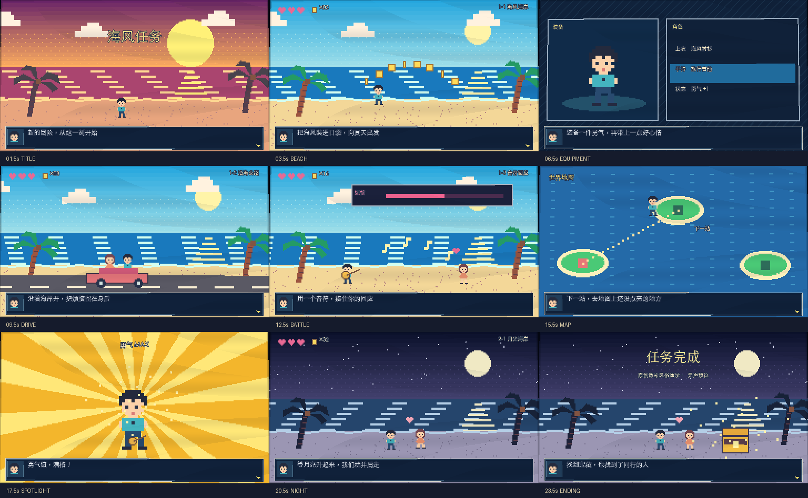
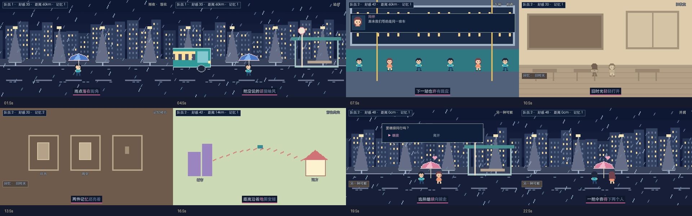
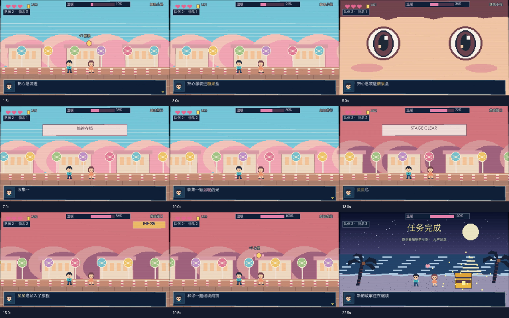

# gpt0-music-mv

一个可复用的 **像素 RPG 叙事音乐视频 skill**：把歌词变成装备、关卡、NPC 对话、音符战斗、世界地图和宝箱奖励，再用固定角色、游戏 HUD 与逐字对白把它们串成 MV。

基于三支用户提供的像素 RPG 参考视频：海滩关卡、雨夜回忆和糖果卷轴。观察见
[海滩参考分析](references/reference-analysis.md)、[雨夜参考分析](references/reference-analysis-rain.md) 和 [卷轴收集参考分析](references/reference-analysis-candy.md)。



上图来自本仓库实际渲染的 24 秒原创文案无声预览。它展示可运行的风格原型，未使用参考视频画面、原曲或原歌词。

雨夜、回忆与选择分支的原创示例：



连续卷轴、收集和进度变化的原创示例：



可替换角色精灵与背景图层的原创示例（展示用无声画面）：


## 用作 Codex skill

将本仓库目录放在你的 skills 目录下，目录名保持 `gpt0-music-mv`。例如：

```sh
git clone https://github.com/wangyaruo/gpt0-music-mv.git ~/.codex/skills/gpt0-music-mv
```

在支持 skills 的环境中调用：

> 使用 $gpt0-music-mv，把我提供的歌曲和 LRC 歌词做成像素 RPG 音乐视频。先把歌词转为游戏事件，再制作固定角色和连贯的关卡叙事。

入口是 [SKILL.md](SKILL.md)，歌曲理解与视觉选择见 [歌曲定位与选景](references/song-direction.md)，详细分镜字段和资产提示词见 [分镜契约](references/storyboard.md)，歌词对齐、精灵图和分层合成见 [素材与歌词流程](references/asset-pipeline.md)。
它不绑定某个付费图像/视频服务，也不宣称能凭成片判断原作者使用的模型。

## 直接运行

需要 Python 3.10+、Pillow、FFmpeg 和支持中文的字体。

```sh
python3 -m pip install -r requirements.txt

# 24 秒无声预览：生成 1024×576、30 fps、H.264 MP4。
python3 scripts/render_mv.py examples/demo.json --out output/demo.mp4

# 24 秒雨夜示例：1280×720、12 fps，含对白、关系状态和卡拉 OK 高亮。
python3 scripts/render_mv.py examples/rain-demo.json --out output/rain-demo.mp4

# 24 秒卷轴示例：1024×576、30 fps，含收集、进度条、特写和视觉快进。
python3 scripts/render_mv.py examples/candy-demo.json --out output/candy-demo.mp4

# 自定义精灵和分层视差的原创无声示例：1280×720、12 fps。
python3 scripts/render_mv.py examples/composite-demo.json --out output/layer-demo.mp4

# 检查一个关键画面。
python3 scripts/render_mv.py examples/demo.json --still 6.5 --out output/equipment.png

# 分析你的参考视频：元数据、带时间戳抽帧、联系表、转场候选和音频信号指标。
python3 scripts/analyze_video.py /path/reference.mp4 --out output/analysis
```

FFmpeg 不在 PATH 时，加 `--ffmpeg /path/to/ffmpeg`，也可设置 `FFMPEG_BIN`。
找不到中文字体时，加 `--font /path/to/NotoSansCJK-Regular.ttc`，也可设置 `MV_FONT`。
脚本会寻找常见的 macOS、Linux 和 Windows 中文字体；字体本身不随仓库分发。

## 用你自己的歌曲

1. 结合用户要求、歌词和实际听感确定主题、情绪、地点、天气与色调，并写明依据；参考片中的雨天不作为默认。
2. 可选运行 `python3 scripts/analyze_song.py my-song.wav --out output/song-analysis.json`，测量时长、分段音量及可选 BPM 候选；这些信号不能自动判断歌曲情绪。
3. 从合适的示例或空白分镜开始，把 `duration` 和 `scenes` 改为真实歌曲时间线，删除不适用的示例设定。
4. 为歌词设计有动作和结果的游戏事件；现有素材不合适时使用自定义角色和图层。
5. 传入音频和歌词时间轴，人工核对同步后交付。

```sh
python3 scripts/render_mv.py my-storyboard.json \
  --audio my-song.wav --lyrics my-song.lrc --out output/my-mv.mp4
```

JSON 内的 `audio`、`lyrics_file`、`font`、场景 `background` 路径相对于 JSON 文件；CLI 参数路径相对于当前目录。
不提供音频会明确输出无声预览。音频短于成片会报错，不偷偷循环、变速或补静音。
输出已存在时默认报错；明确替换产物可加 `--overwrite`。

### 当前能力

| 能力 | 实现 |
|---|---|
| 像素场景 | 海滩、雨夜城市、公交站、公交车厢、教室、书店、记忆卡片、城市地图、糖果卷轴 |
| 游戏叙事 | 装备、驾车、战斗、地图、回忆、选择菜单、收集、存档提示、通关、视觉快进和特写 |
| 角色动画 | 原创角色或外部 PNG 精灵图；动画帧、速度、锚点、朝向和头像可配置 |
| 状态与字幕 | 事件驱动的金币/物品/进度条、队伍/好感/距离、独立对白、卡拉 OK 与关键词颜色 |
| 连续卷轴 | 分层 PNG、独立视差、重复铺设、角色关键帧；相同分支与世界的相机位置可继承 |
| 歌词 | JSON/LRC；可将 WhisperX 词时间与已确认歌词匹配为待听音校正的草稿 |
| 视频 | 最近邻整数放大、轻 CRT、H.264、可选 AAC 音频、成片元数据检查 |
| 参考分析 | 定时抽帧、联系表、转场候选；安装可选 NumPy 后提供 BPM 候选 |

公交站默认无雨，雨夜城市默认有雨；两种内置城市底图均为夜景，`weather: clear` 不会将其变成白天。原片中的酒吧、俯视脚印、篝火、背包网格、摩天轮和更复杂的镜头运动仍需扩展场景或提供资产。
存档点只是一段画面，不会保存游戏进度；视觉快进不改变音频速度。
程序化像素资产在 `scripts/pixel_world.py` 中，可替换配色、人物图案和场景。
基础安装不包含语音识别或自动音乐生成。可选 WhisperX 必须另行安装并准备模型；自动匹配结果需要听音校对，无法匹配的行需要人工补全。只有句级 LRC 时的逐字高亮是近似阅读动画。
分词时间戳的来源按用户声明记录，并不自动代表已听音核验。BPM 候选存在半拍/倍拍歧义，必须核对。

## 仓库结构

```text
SKILL.md                      技能入口
agents/openai.yaml            技能展示信息
references/reference-analysis.md  原片观察、实测参数与结构
references/reference-analysis-rain.md 第二支参考片及增补方法
references/reference-analysis-candy.md 第三支参考片及卷轴方法
references/storyboard.md      歌词映射、分镜契约、资产提示词
scripts/analyze_video.py      参考视频分析
scripts/analyze_song.py       歌曲时长、分段 RMS 和可选 BPM 候选
references/song-direction.md  歌曲定位与场景选择
scripts/render_mv.py          时间轴、对白与视频合成
scripts/pixel_world.py        原创像素角色和场景
scripts/rain_scenes.py        雨夜城市、公交、回忆与地图
scripts/candy_scenes.py       糖果世界、分层卷轴和眼睛特写
scripts/narrative_events.py   定时事件、状态继承与相机位置
scripts/align_lyrics.py       将确认歌词和 WhisperX 词时间匹配为可编辑草稿
scripts/sprite_assets.py      外部角色精灵图加载
scripts/layer_compositor.py   图像、角色、关键帧与视差合成
references/asset-pipeline.md  素材与歌词对齐说明
examples/composite-demo.json  自定义精灵和多层视差示例
scripts/media_utils.py        FFmpeg 查找与元数据读取
examples/demo.json            可直接渲染的九场景样例
examples/rain-demo.json       雨夜与分支叙事样例
examples/candy-demo.json      卷轴、收集与进度变化样例
assets/preview.png            由样例生成的画面预览
tests/                        时间轴、状态、字幕与渲染检查
```

## 验证

```sh
python3 -m unittest discover -s tests -v
```

开发验证已实际执行：
- 时间轴、分支状态、LRC、字词高亮及音频合成均有自动检查。
- 24 秒无声示例：1024×576、30 fps、H.264，时长与配置一致。
- 2 秒自制测试音频合成：确认 MP4 存在音轨且时长正确；测试音不是示例配乐。
- 分析脚本运行于原始视频：18 张抽帧、30 个合并后的画面变化候选。
- 查看九个关键场景的渲染预览，确认中文与对白区域可见。
- 雨夜示例的原创无声画面为 1280×720、12 fps；其歌词、时间戳和剧情只用于演示。
- 卷轴示例的原创无声画面为 1024×576、30 fps；事件、字幕和道具均为演示数据。

`output/`、原始视频及音频文件都被 Git 忽略。此仓库只发布 skill、代码、原创示例配置和原创预览图。

实现参考：[FFmpeg 文档](https://ffmpeg.org/ffmpeg.html)、[Pillow Image 文档](https://pillow.readthedocs.io/en/stable/reference/Image.html)。
